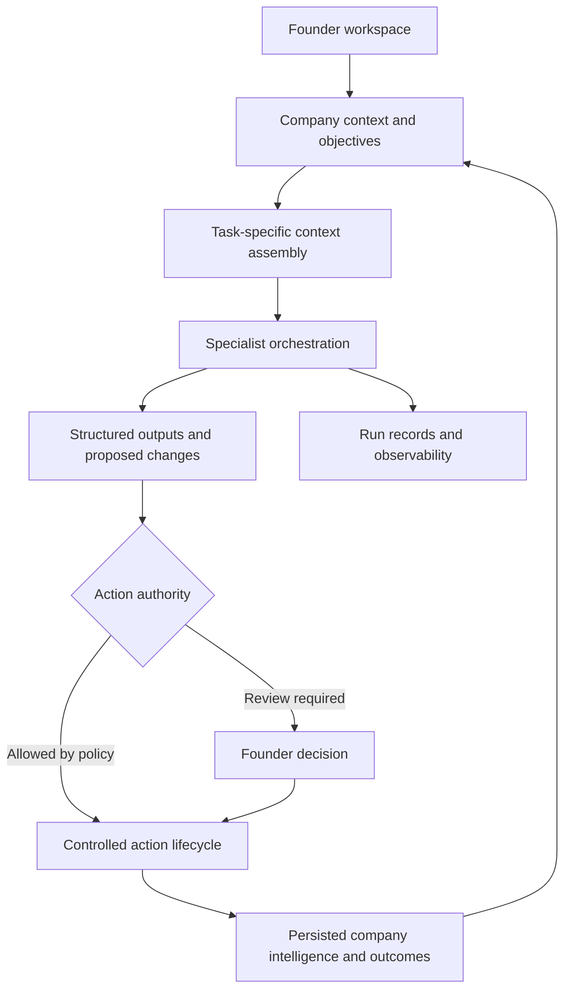

# Foundessa — AI-Native Company-Building Platform

Foundessa is an AI-native company-building platform for founders, combining persistent company intelligence, specialized AI agents, and structured execution. It is designed to support company-building work across strategy, market, product, growth, finance, and operations.

## Product

Foundessa helps founders connect company goals, evidence, decisions, and work over time. Its implemented system includes company workspaces, AI-assisted analysis, specialist orchestration, approval surfaces, and commercial infrastructure. The product is currently being prepared for launch.

## Problem

A conversation can produce useful advice without preserving why a decision was made or what happened next. Company-building software needs durable context, traceable work, and clear authority for actions across several business functions.

## What I Built

I designed and built the product and application architecture: a persistent company environment, structured intelligence workflows, specialist orchestration, approval interactions, and the SaaS services around them. The repository contains implementation and tests for orchestration dependencies, action transitions, company intelligence updates, entitlements, billing, and access boundaries.

## What This Demonstrates

AI workflow architecture · persistent context · specialist coordination · human review · SaaS tenancy · subscription infrastructure · testable authorization and action lifecycles.

## Architecture

This diagram shows product and service boundaries, not infrastructure topology or database structure.

## Technical Stack

Next.js · React · TypeScript · Tailwind CSS · Supabase Auth/Postgres/Storage · Vercel AI SDK · OpenAI · Zod · Stripe · Resend · PostHog · Sentry instrumentation · Upstash rate-limiting support · Vitest · Playwright · axe-core · Vercel deployment configuration.

## Engineering Decisions

### 1. Persist company intelligence independently of chat

Company data, evidence, and reviewed changes live outside the conversation transcript. That gives subsequent workflows a durable starting point and distinguishes generated suggestions from canonical product state.

### 2. Assemble context for the task

Context is composed for the work being performed rather than sending every company record to every AI call. The architectural boundary supports relevance and company isolation.

### 3. Coordinate specialists through an action lifecycle

The orchestration implementation accounts for dependencies, prior outputs, failure, retry, cancellation, and waiting for review. Coordination is explicit product state rather than an opaque sequence of model calls.

### 4. Treat authority as a separate decision

Stored action authority and review flows sit between proposed work and consequential changes. The implementation includes cancellation checks before canonical writes; generated output does not itself grant permission.

### 5. Build the commercial and reliability envelope alongside AI

Entitlements, signed billing webhooks, reconciliation, run records, analytics, and rate-limit adapters support the surrounding SaaS system. AI functionality is one part of the application architecture.

## Production Considerations

The repository includes unit tests, orchestration integration tests, database isolation test assets, browser-test configuration, and accessibility checks. Billing handles signed events and includes replay-control and reconciliation logic. Monitoring and analytics are instrumented through Sentry and PostHog, with rate-limit support and persisted AI run lifecycles. These are implemented engineering controls; this case study does not claim commercial launch, production traffic, or a completed operational audit.

## Current Implementation and Direction

The case study describes implemented architecture and controls. Broader autonomous company operations remain subject to launch validation and connector configuration; architecture coverage does not imply that every external action has been proven in a live deployment.

## Verified Engineering Evidence

A fresh run of the current application's Vitest suite passed **311 tests across 60 files**, covering orchestration, action transitions, autonomy policies, context assembly, access checks, billing, and related application logic. This is automated test evidence from an isolated checkout; it does not assert live connector coverage or a production deployment.

Checks were run on October 13, 2026. Test results describe the stated scope and are not customer or business outcome claims.

## Source Policy

The commercial application repository remains private to protect proprietary product logic and IP. This case study is independently written architecture documentation. It excludes production source code, credentials, customer data, private prompts, detailed database schemas, and security-sensitive implementation details.
